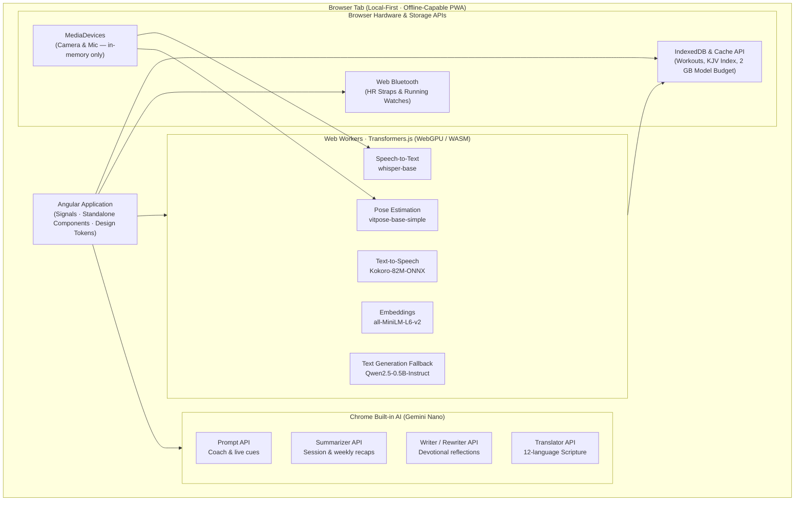

<p align="center">
  <picture>
    <source media="(prefers-color-scheme: dark)" srcset="docs/assets/haloop-logo-dark.svg">
    <source media="(prefers-color-scheme: light)" srcset="docs/assets/haloop-logo-light.svg">
    
  </picture>
</p>

<h1 align="center">Haloop</h1>

<p align="center">
  <a href="LICENSE"></a>
  <a href="https://angular.dev"></a>
  <a href="https://developer.chrome.com/docs/ai/built-in"></a>
  <a href="https://huggingface.co/docs/transformers.js"></a>
  <a href="https://developer.mozilla.org/en-US/docs/Web/API/WebGPU_API"></a>
  <a href="docs/design-system/tokens/contrast-pairs.json"></a>
  <a href="CONTRIBUTING.md"></a>
</p>

**Haloop** is a local-first, privacy-by-design movement coaching, wearable telemetry, and daily devotional web application. Every AI model Haloop uses runs entirely inside your browser tab—combining Chrome's built-in **Gemini Nano** APIs with **Hugging Face** open models executed via **Transformers.js** on **WebGPU** (with automatic WebAssembly CPU fallback) and direct **Web Bluetooth** wearable connectivity.

> [!NOTE]
> **Project Status:** Haloop is under active development. The full interactive HTML mock suite ([`docs/mocks/`](docs/mocks/README.md)) and design system tokens ([`docs/design-system/`](docs/design-system/)) are complete; the Angular application and on-device ML pipelines are being delivered incrementally against those specifications.

---

## Table of Contents

- [Why Haloop?](#why-haloop)
- [Key Features](#key-features)
- [Architecture](#architecture)
- [On-Device AI Stack](#on-device-ai-stack)
- [Prerequisites & Browser Support](#prerequisites--browser-support)
- [Getting Started](#getting-started)
- [Project Structure](#project-structure)
- [Design System & Interactive Mocks](#design-system--interactive-mocks)
- [Privacy & Local-First Guarantees](#privacy--local-first-guarantees)
- [Contributing](#contributing)
- [Security](#security)
- [Support](#support)
- [License](#license)

---

## Why Haloop?

Modern fitness and devotional apps routinely upload camera feeds, voice recordings, biometric streams, and personal reflections to remote servers. Haloop takes the opposite stance:

- **Zero cloud relay:** Pose estimation, speech-to-text, text-to-speech, conversational coaching, semantic Scripture search, and translation all run locally in the browser tab.
- **No mandatory accounts:** First-run onboarding (`/welcome`) checks browser capabilities and stores preferences locally—no login wall or backend database required.
- **Offline-ready by default:** Once open models are cached inside the user-controlled 2 GB cache budget, workouts, live form cues, voice commands, and Scripture search work completely offline.
- **Direct wearable integration:** Connects to heart-rate straps and running watches over Web Bluetooth with no companion phone app or cloud bridge.

---

## Key Features

| Area | Route | Capabilities |
|---|---|---|
| **Today** | `/` | Daily Scripture card (KJV with 12-language on-device translation), scheduled movement plan, streak and resting HR summary, and weekly readiness KPIs. |
| **Train** | `/train` | Live camera workout studio powered by local WebGPU pose estimation (`vitpose-base-simple`), real-time rep counting and form scoring, live Bluetooth heart-rate zones, hands-free Whisper voice commands, and spoken Kokoro TTS coaching cues. |
| **Coach** | `/coach` | Private on-device AI Coach (Chrome Gemini Nano Prompt API, with optional `Qwen2.5-0.5B-Instruct` fallback) for workout adjustments, recovery advice, devotional reflections, and semantic KJV Scripture search. |
| **History & Session Detail** | `/history`, `/history/:id` | Searchable local workout log with per-session form scores, rep counts, heart-rate summaries, and Gemini Nano-generated session and weekly recaps. |
| **Devices** | `/devices` | Direct Web Bluetooth pairing, battery monitoring, and live telemetry for heart-rate chest straps (e.g., Polar H10, Wahoo TICKR Fit, Garmin HRM-Pro Plus) and running watches (e.g., Coros Pace 3). |
| **AI Lab** | `/lab` | Transparent inspection of Chrome Built-in AI availability (with guided `chrome://flags` setup) and Hugging Face open-model downloads, removal, WebGPU/WASM backend status, and 2 GB cache budget tracking. |
| **Settings & Onboarding** | `/settings`, `/welcome` | Display name, Scripture language, WebGPU vs. WASM compute preference, configurable model cache budget, voice cue toggles, and local data export. |

---

## Architecture

Haloop is structured as a standalone, zoneless **Angular** progressive web application (PWA) that delegates compute-intensive ML inference to dedicated Web Workers and persists all user data and model weights locally.



---

## On-Device AI Stack

### Built into Chrome (Gemini Nano)

Managed directly by Chrome with no extra storage counted against Haloop's open-model budget:

| Chrome API | Role in Haloop | Notes |
|---|---|---|
| **Prompt API** | Coach conversations and real-time workout cues | Falls back to `Qwen2.5-0.5B-Instruct` when unavailable |
| **Summarizer API** | Post-workout and weekly progress recaps | Runs locally on session history |
| **Writer & Rewriter API** | Tailored devotional reflections | Requires `chrome://flags/#writer-api-for-gemini-nano` when gated |
| **Translator API** | On-device Scripture translation | Supports 12 languages from the local KJV index |

### Open Models (Hugging Face · Transformers.js)

Downloaded once on demand into the browser's local cache (default **2 GB budget**, **286 MB** cached for the core 4 models):

| Capability | Hugging Face Model | Task | Approx. Size | Default State |
|---|---|---|---|---|
| **Rep counting & form** | [`onnx-community/vitpose-base-simple`](https://huggingface.co/onnx-community/vitpose-base-simple) | Pose estimation (camera) | 94 MB | Cached |
| **Voice commands** | [`onnx-community/whisper-base`](https://huggingface.co/onnx-community/whisper-base) | Speech-to-text | 77 MB | Cached |
| **Coach voice** | [`onnx-community/Kokoro-82M-ONNX`](https://huggingface.co/onnx-community/Kokoro-82M-ONNX) | Text-to-speech | 92 MB | Cached |
| **Verse search** | [`Xenova/all-MiniLM-L6-v2`](https://huggingface.co/Xenova/all-MiniLM-L6-v2) | Semantic embeddings (KJV index) | 23 MB | Cached |
| **Coach fallback** | [`onnx-community/Qwen2.5-0.5B-Instruct`](https://huggingface.co/onnx-community/Qwen2.5-0.5B-Instruct) | Text generation (when Nano is off) | 480 MB | Optional download |

---

## Prerequisites & Browser Support

### Runtime Browser Requirements

| Capability | Recommended | Fallback |
|---|---|---|
| **Browser** | Google Chrome 138+ (Desktop / Android) | Any modern browser with WebAssembly (limited features; `/unsupported` guides fallback) |
| **GPU Acceleration** | WebGPU enabled | Automatic WebAssembly (WASM) CPU backend |
| **Built-in AI** | Chrome Gemini Nano enabled | Optional local `Qwen2.5-0.5B-Instruct` via Transformers.js |
| **Wearables** | Web Bluetooth enabled | Manual workout logging without HR telemetry |
| **Camera / Mic** | `getUserMedia` permission | Timer-only & text-only training modes |

To enable the optional Gemini Nano Writer & Rewriter API in Chrome:

1. Open `chrome://flags/#writer-api-for-gemini-nano`.
2. Set the flag to **Enabled** and relaunch Chrome.
3. Open **AI Lab** (`/lab`) inside Haloop to verify availability.

### Local Development Prerequisites

- **Node.js** 22 LTS (or current Angular-supported LTS)
- **npm** 10+ (or pnpm)
- **Python 3.10+** (optional, for running HTML mock and design-system verification scripts)

---

## Getting Started

### 1. Clone the repository

```bash
git clone https://github.com/QuinntyneBrown/haloop.git
cd haloop
```

### 2. Explore the interactive UI mocks & design system (available today)

No build step is required to preview every screen, dialog, and notification state:

```bash
open docs/mocks/index.html
```

- Press `t` (or append `?theme=dark` / `?theme=light`) to switch themes.
- Append `?chrome=0` for clean, frameless screenshots.
- Verify mock integrity and accessibility structure:

```bash
python3 .agents/skills/writing-html-mocks/scripts/check_mocks.py docs/mocks --write
```

### 3. Run the Angular application (target implementation workflow)

Once the Angular workspace is scaffolded in the repository root:

```bash
npm install
npm start          # Starts the local dev server at http://localhost:4200
```

Common scripts in the target workspace:

```bash
npm test           # Run unit tests (Vitest / Angular test runner)
npm run build      # Production build with PWA service worker
npm run lint       # Lint TypeScript, templates, and stylesheets
```

---

## Project Structure

```text
haloop/
├── .agents/                    # Project skills and agent automation scripts
├── .github/                    # Issue/PR templates and Copilot instructions
├── docs/
│   ├── design-system/          # Extracted design tokens (DTCG JSON, CSS), contrast audit, components
│   ├── detailed-designs/       # Per-subsystem C4, class, and sequence design docs (planned)
│   ├── estimates/              # Effort sizing and implementation roadmap (planned)
│   ├── mocks/                  # Static HTML mocks for every page, dialog, and notification state
│   └── specs/                  # L1/L2 software requirements and acceptance criteria (planned)
├── src/                        # Angular application source (target implementation)
│   ├── app/
│   │   ├── core/               # On-device AI orchestrator, Web Workers, Web Bluetooth, IndexedDB
│   │   ├── features/           # Route-level features (today, train, coach, history, devices, ai-lab, settings, onboarding)
│   │   └── shared/             # Design-system UI primitives, pipes, and accessibility helpers
│   └── styles/                 # Design tokens and light/dark theme stylesheets
├── AGENTS.md                   # Canonical instructions for AI coding agents
├── CHANGELOG.md                # Release history
├── CODE_OF_CONDUCT.md          # Community standards
├── CONTRIBUTING.md             # Contribution workflow and coding standards
├── LICENSE                     # MIT License
├── SECURITY.md                 # Vulnerability disclosure policy
└── SUPPORT.md                  # Help and troubleshooting resources
```

---

## Design System & Interactive Mocks

Haloop follows a **design-before-code** workflow:

- **Interactive Mocks:** [`docs/mocks/README.md`](docs/mocks/README.md) documents all 12 pages, 5 dialogs, and 3 notification families across every required state (`default`, `loading`, `empty`, `error`, `paused`, `submitting`, `downloading`, `wasm`, `invalid`, `success`, `busy`, `failed`, and notification severities).
- **Design Tokens:** [`docs/design-system/tokens/tokens.json`](docs/design-system/tokens/tokens.json) and [`docs/design-system/tokens/tokens.css`](docs/design-system/tokens/tokens.css) define the complete light and dark palettes, typography (`Outfit`, `Inter`, `JetBrains Mono`), 4px spacing scale, responsive breakpoints, elevation, motion, and WCAG 2.2 AA verified contrast pairs ([`contrast-pairs.json`](docs/design-system/tokens/contrast-pairs.json)).

---

## Privacy & Local-First Guarantees

1. **Camera frames never leave memory:** Pose estimation runs frame-by-frame in a local WebGPU/WASM worker; video is never recorded or transmitted.
2. **Voice stays on-device:** Whisper speech-to-text and Kokoro text-to-speech process audio strictly inside the browser.
3. **No telemetry or analytics:** Haloop makes network requests only when you explicitly download an open model from Hugging Face (or load the static app shell).
4. **Full user ownership:** Workout history, device metadata, and settings live in browser storage and can be exported or cleared at any time.

---

## Contributing

Contributions are welcome! Please read [CONTRIBUTING.md](CONTRIBUTING.md) and our [Code of Conduct](CODE_OF_CONDUCT.md) before opening a pull request.

We follow an incremental, specification-driven workflow:
1. Define or update requirements (`docs/specs/`) and detailed designs (`docs/detailed-designs/`).
2. Update HTML mocks (`docs/mocks/`) and design tokens (`docs/design-system/`) for any visible UI change.
3. Implement in small, test-first vertical slices adhering to WCAG 2.2 AA accessibility.

---

## Security

If you discover a security vulnerability, please **do not** open a public issue. Follow the responsible disclosure process in [SECURITY.md](SECURITY.md).

---

## Support

For usage questions, Chrome flag troubleshooting, or feature discussions, see [SUPPORT.md](SUPPORT.md).

---

## License

This project is licensed under the **MIT License** — see the [LICENSE](LICENSE) file for details.
