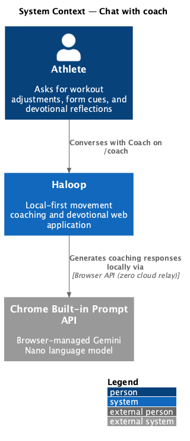
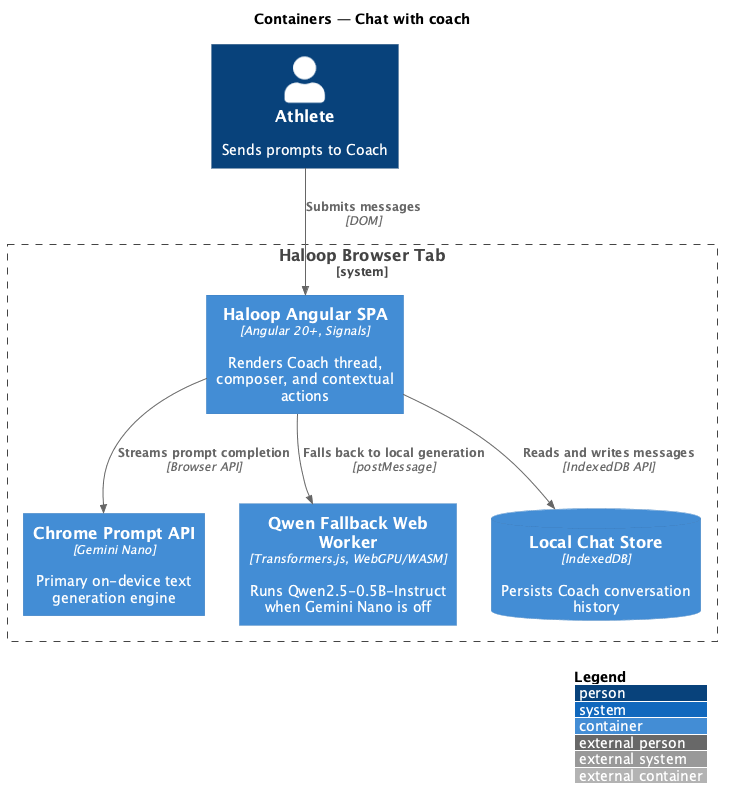
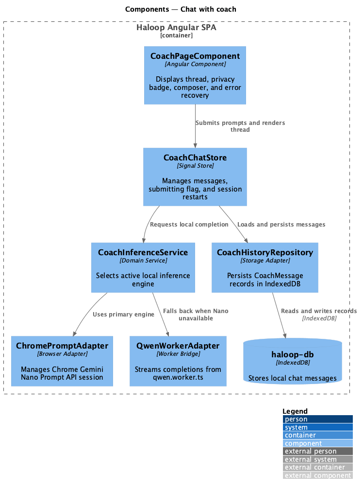
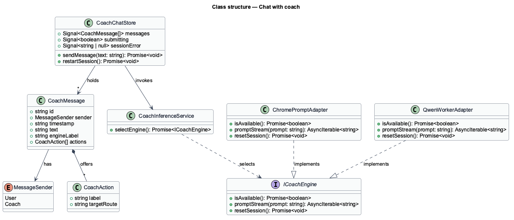
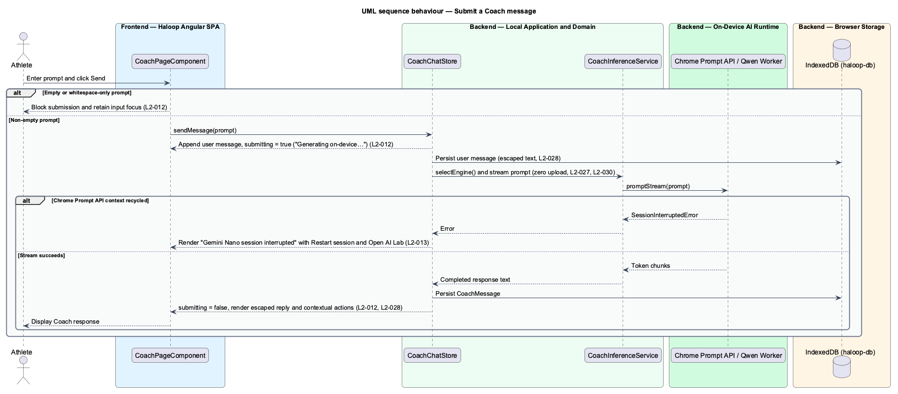

# Chat with coach

## Overview

Haloop Coach at `/coach` provides private, conversational guidance for workout adjustments, recovery planning, and devotional reflections without sending prompts to a cloud service. **Coach inference provider** — local language-model adapter using Chrome's built-in Gemini Nano Prompt API as primary backend and optionally falling back to a cached `onnx-community/Qwen2.5-0.5B-Instruct` Transformers.js Web Worker when Gemini Nano is unavailable. **Prompt API session** — in-memory Chrome language-model context that can be recycled by the browser after tab inactivity.

When the athlete submits a message, the composer transitions to a disabled `Sending` state displaying `Generating on-device…` while streaming tokens locally. Assistant replies can include contextual actions such as applying a light-load warm-up directly to `/train` or translating a cited Scripture passage. If Chrome recycles the Prompt API session, `/coach` renders a recoverable error state offering `Restart session` or `Open AI Lab` to download the Qwen fallback model.

## Description

The slice connects the Angular Coach UI to the local language-model provider abstraction, fallback Web Worker, and IndexedDB conversation store.

- **`CoachPageComponent`** — standalone Angular component at `/coach`. It renders the `On-device · Private` privacy badge, chronological message thread, contextual action buttons, message composer, and loading, empty, submitting, and interrupted-session error states.
- **`CoachChatStore`** — Signal-backed store managing `CoachMessage[]`, active inference engine label, streaming state, and error recovery (`restartSession()`).
- **`CoachInferenceService`** — Angular strategy service delegating generation to `ChromePromptAdapter` when Gemini Nano is available, or `QwenWorkerAdapter` (`qwen.worker.ts`) when Gemini Nano is unavailable and Qwen is cached.
- **Qwen fallback engine** — as implemented, `ChromeAiService` falls back to `MlWorkerClient`, which messages the shared `ml-inference.worker.ts`; the worker delegates to `qwen-engine.ts`. The engine lazily imports Transformers.js, loads the `q4f16` (~480 MB) weights on WebGPU when an adapter with `shader-f16` exists and the Settings backend is not `WASM CPU`, and otherwise on WASM CPU. It also falls back to WASM CPU when the WebGPU session cannot be created, when the GPU device is lost mid-generation, or when a one-word load-time output check fails (some GPU drivers emit garbage tokens for fp16 graphs); that last verdict is remembered locally so later sessions skip WebGPU until the model is removed. Remote model access is disabled except during an explicit AI Lab download, and downloads and prompts share one serialized queue so no prompt runs while remote access is open (`L2-027`). ONNX Runtime WASM binaries are served from the app origin (`/ort/`). When the model is not cached or generation fails, the worker returns a deterministic reply labelled `Deterministic fallback`.
- **`CoachHistoryRepository`** — IndexedDB adapter persisting local conversation messages in `haloop-db`.
- **`CoachMessage`** — immutable domain record holding `id`, `sender` (`User` or `Coach`), `timestamp`, `text`, `engineLabel`, and optional `CoachAction[]`.

## Requirements

The feature realizes the following level-2 (L2) requirements. Each L2 requirement refines a level-1 (L1) requirement, cited by identifier.

| L2 ID | Refines (L1) | Requirement |
|-------|--------------|-------------|
| `L2-012` | `L1-005` | The `/coach` route shall run conversational coaching via Chrome's Gemini Nano Prompt API (or cached `Qwen2.5-0.5B-Instruct` fallback), displaying `On-device · Private`, streaming feedback, contextual actions, and blocking blank submissions. |
| `L2-013` | `L1-005` | The `/coach` route shall handle thread loading skeletons, empty starter state (`Start a conversation`, `Search Scripture`), and interrupted Prompt API session errors (`Restart session`, `Open AI Lab`). |
| `L2-027` | `L1-011` | Coach prompts and responses shall execute strictly on-device with zero outbound network transmission. |
| `L2-028` | `L1-011` | User prompts and AI-generated replies shall be validated and rendered strictly as escaped text to prevent DOM XSS. |
| `L2-030` | `L1-012` | Optional `Qwen2.5-0.5B-Instruct` fallback inference shall execute inside a dedicated Web Worker keeping UI interaction latency `<= 100 ms`. |

## Diagrams

### System context

The athlete converses with Haloop Coach locally in Chrome using either Gemini Nano or a cached local open model, with zero cloud relay.

### Containers

The Angular SPA orchestrates Chrome's Prompt API and the optional Qwen Transformers.js Web Worker, persisting thread history in IndexedDB.

### Components

`CoachPageComponent` binds to `CoachChatStore`, which delegates generation to `CoachInferenceService` (`ChromePromptAdapter` or `QwenWorkerAdapter`) and persists messages via `CoachHistoryRepository`.

### Class structure

`CoachInferenceService` implements a strategy over `ICoachEngine`, realized by `ChromePromptAdapter` and `QwenWorkerAdapter`, producing escaped `CoachMessage` entities.

### Behaviour — submit a Coach message

Submitting a non-empty prompt enters `submitting` state (`L2-012`), executes locally via Gemini Nano or Qwen Web Worker (`L2-027`, `L2-030`), renders escaped output (`L2-028`), and handles Prompt API session interruption (`L2-013`).

