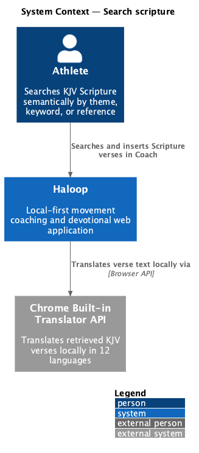
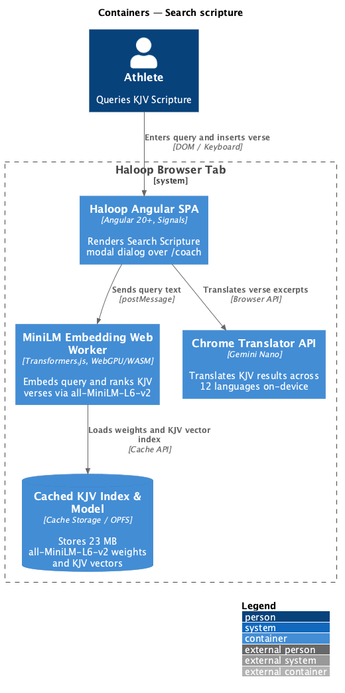
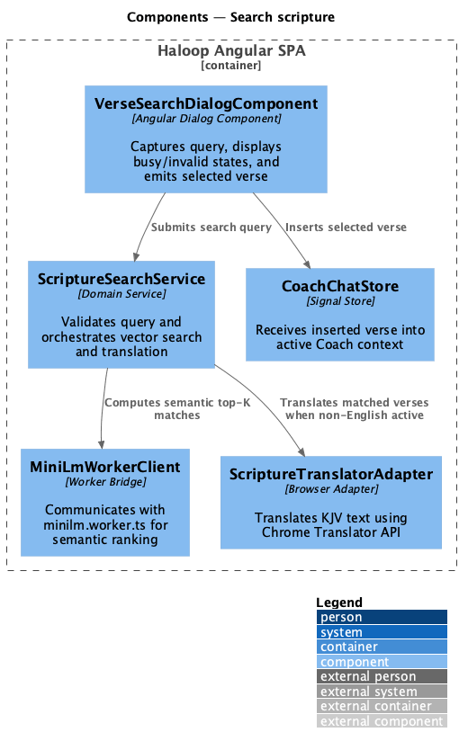
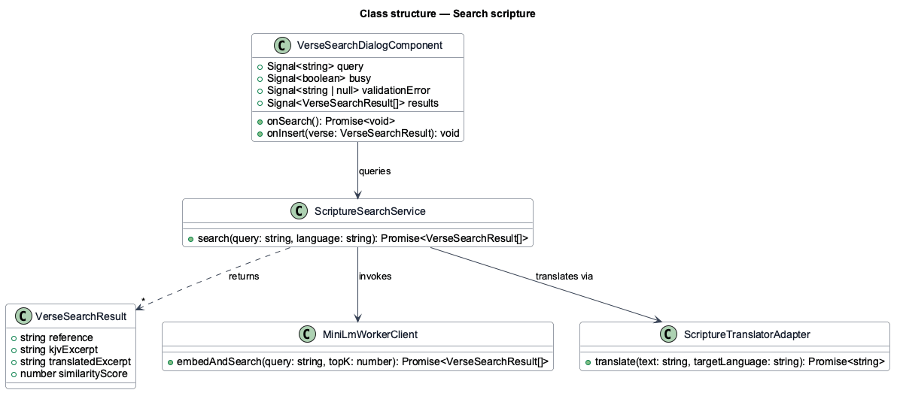
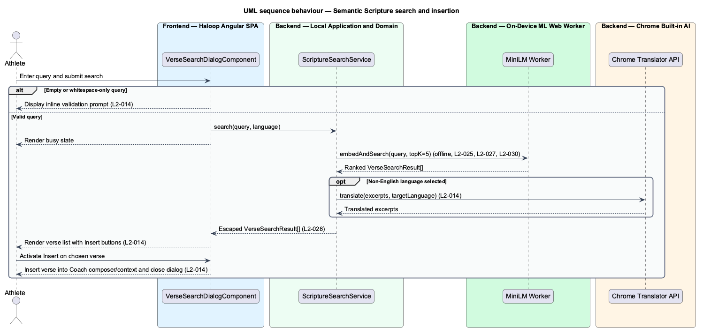

# Search scripture

## Overview

Haloop includes an offline, semantic King James Version (KJV) Scripture search accessible from Coach via the modal `Search Scripture` dialog. **Semantic verse index** — precomputed vector embedding table of KJV verses stored locally and queried via cosine similarity using `Xenova/all-MiniLM-L6-v2` (`23 MB`). **On-device verse translation** — local translation of retrieved KJV passages into `12` supported languages via Chrome's built-in Translator API.

The athlete enters a theme, keyword, or reference (such as `"endurance and patience"` or `"Psalm 23"`), receives ranked KJV results computed inside a Web Worker, and activates `Insert` to inject the verse into the Coach conversation context. Blank queries trigger inline validation guidance, and all computation executes offline with zero remote requests.

## Description

The slice connects the modal search dialog to the MiniLM embedding Web Worker, local vector store, and Chrome Translator adapter.

- **`VerseSearchDialogComponent`** — standalone modal Angular dialog (`role="dialog"`, `aria-modal="true"`, Escape dismissal, `inert` background). It renders the search input, validation message (`invalid` state), `busy` spinner, ranked verse list, and per-verse `Insert` button.
- **`ScriptureSearchService`** — Angular service validating non-empty queries, invoking `MiniLmWorkerClient`, and translating returned verses via `ScriptureTranslatorAdapter` when a non-English language is selected.
- **`MiniLmWorkerClient`** — typed Web Worker bridge to `minilm.worker.ts` running `Xenova/all-MiniLM-L6-v2` to embed the query and rank top-K KJV verses by cosine similarity.
- **`ScriptureTranslatorAdapter`** — wrapper around Chrome's built-in Translator API supporting `12` languages on-device.
- **`VerseSearchResult`** — immutable result record containing `reference`, `kjvExcerpt`, `translatedExcerpt`, and `similarityScore`.

## Requirements

The feature realizes the following level-2 (L2) requirements. Each L2 requirement refines a level-1 (L1) requirement, cited by identifier.

| L2 ID | Refines (L1) | Requirement |
|-------|--------------|-------------|
| `L2-014` | `L1-005` | Activating `Search Scripture` from `/coach` shall open a modal dialog running semantic vector search over the cached KJV index via `Xenova/all-MiniLM-L6-v2`, validating non-empty queries, showing `busy` state, inserting selected verses into Coach, and translating across 12 languages locally via Chrome's Translator API. |
| `L2-025` | `L1-010` | Cached KJV semantic Scripture search shall operate with zero network connectivity. |
| `L2-027` | `L1-011` | Semantic Scripture search and translation shall execute locally with zero outbound network requests. |
| `L2-028` | `L1-011` | Search queries and returned verse excerpts shall be rendered strictly as escaped text to prevent DOM XSS. |
| `L2-030` | `L1-012` | `Xenova/all-MiniLM-L6-v2` embedding inference shall run inside a dedicated Web Worker keeping UI responsiveness `<= 100 ms`. |

## Diagrams

### System context

The athlete searches KJV Scripture by theme or reference inside Haloop using local vector embeddings and Chrome's built-in Translator API.

### Containers

The Angular SPA dispatches search queries to the MiniLM Web Worker, reads the cached KJV embedding index, and translates verses via Chrome's Translator API.

### Components

`VerseSearchDialogComponent` calls `ScriptureSearchService`, which coordinates `MiniLmWorkerClient` and `ScriptureTranslatorAdapter`.

### Class structure

`ScriptureSearchService` orchestrates `MiniLmWorkerClient` and `ScriptureTranslatorAdapter` to return ranked `VerseSearchResult` items to `VerseSearchDialogComponent`.

### Behaviour — semantic Scripture search and insertion

Submitting a non-empty query runs MiniLM embedding search in a Web Worker (`L2-014`, `L2-030`), optionally translates locally (`L2-014`, `L2-027`), and inserts the chosen verse into Coach (`L2-014`, `L2-028`).

