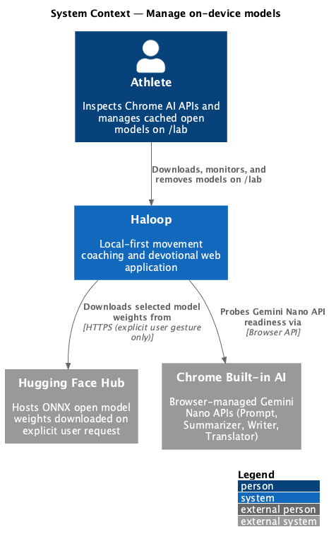
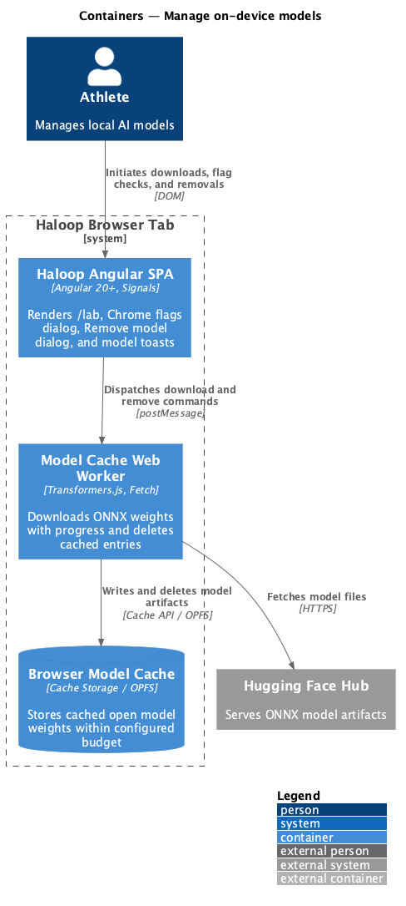
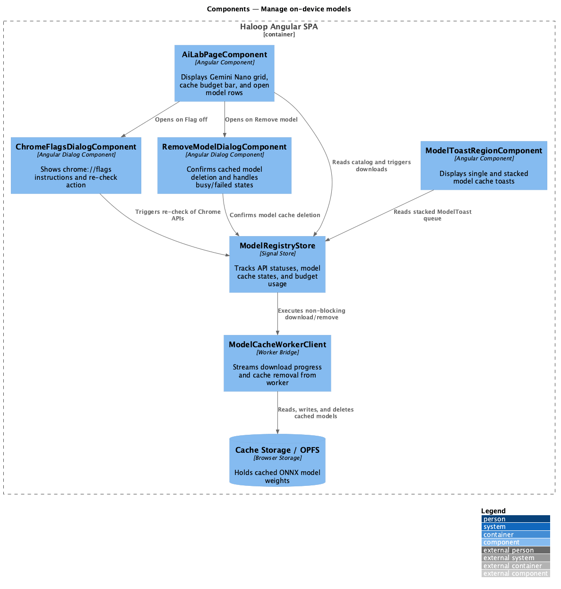
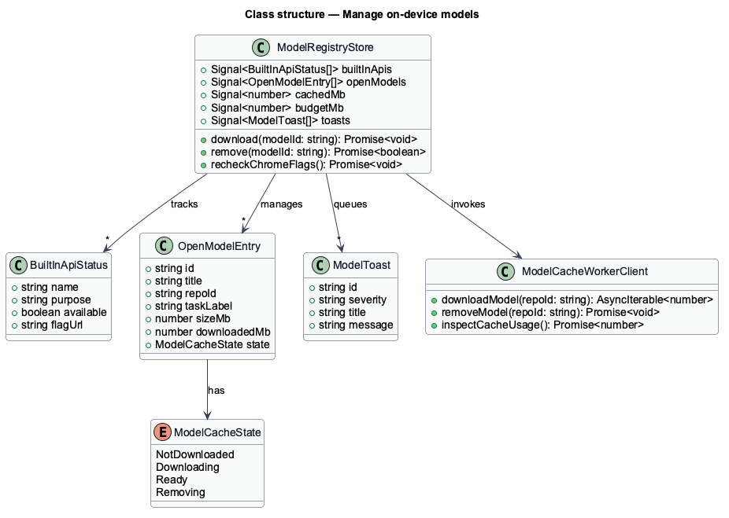
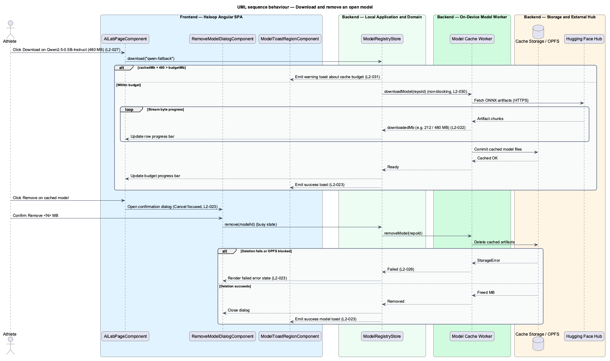

# Manage on-device models

## Overview

The AI Lab at `/lab` gives the athlete transparent control over every artificial intelligence capability running inside the browser tab. **Built-in Chrome AI catalog** — live readiness table of Chrome's four Gemini Nano APIs (`Prompt API`, `Summarizer`, `Writer & Rewriter`, and `Translator`), including step-by-step flag enablement when `Writer & Rewriter` is `Flag off`. **Open model catalog** — management list of five Hugging Face models executed via Transformers.js (`onnx-community/vitpose-base-simple` `94 MB`, `onnx-community/whisper-base` `77 MB`, `onnx-community/Kokoro-82M-ONNX` `92 MB`, `Xenova/all-MiniLM-L6-v2` `23 MB`, and `onnx-community/Qwen2.5-0.5B-Instruct` `480 MB`) tracked against the user's local cache budget.

All downloads are explicitly initiated by the athlete, report live byte progress (such as `212 / 480 MB`), enforce the configured cache budget before committing storage, and support safe removal via the modal `remove-model` confirmation dialog. When WebGPU is unavailable, `/lab` displays the `Running on CPU via WebAssembly` notice while keeping every open model manageable; when Origin Private File System (OPFS) or Cache Storage is blocked, `/lab` reports the storage error while continuing to display Chrome built-in API availability.

## Description

The slice coordinates the AI Lab page, Chrome flags and model removal dialogs, stacked model cache toasts, the model download Web Worker, and browser cache storage.

- **`AiLabPageComponent`** — standalone Angular component at `/lab`. It renders the Chrome built-in API grid, cache budget progress bar (`role="progressbar"`), open model rows with `rel="noreferrer"` Hugging Face links, and `default`, `loading`, `empty`, `downloading`, `wasm`, and `error` states.
- **`ChromeFlagsDialogComponent`** — modal dialog opened when activating `Flag off`. It presents `chrome://flags/#writer-api-for-gemini-nano` instructions and a `Re-check Chrome flags` action with a `busy` probing state.
- **`RemoveModelDialogComponent`** — modal confirmation dialog naming the repository ID, megabytes to be freed, and affected feature, with `Cancel` focused by default and `busy` / `failed` deletion states.
- **`ModelToastRegionComponent`** — accessible toast container supporting `info`, `success`, `warning`, `danger`, and `stacked` model cache notifications.
- **`ModelRegistryStore`** — Signal-backed store tracking `BuiltInApiStatus[]`, `OpenModelEntry[]`, `cachedMb`, `budgetMb`, active download progress, and `ModelToast[]`.
- **`ModelCacheWorkerClient`** — typed Web Worker bridge downloading Hugging Face ONNX artifacts into Cache Storage / OPFS and deleting cached artifacts without blocking the UI thread.

## Requirements

The feature realizes the following level-2 (L2) requirements. Each L2 requirement refines a level-1 (L1) requirement, cited by identifier.

| L2 ID | Refines (L1) | Requirement |
|-------|--------------|-------------|
| `L2-021` | `L1-008` | The `/lab` route shall report availability of Chrome's four Gemini Nano APIs and open the `chrome-flags` modal dialog with flag instructions and `Re-check Chrome flags` verification when `Flag off` is activated. |
| `L2-022` | `L1-008` | The `/lab` route shall list the five Hugging Face open models with sizes, repository links, download progress, accessible cache budget progress bar, and `empty`, `loading`, `downloading`, `wasm`, and blocked-storage `error` states. |
| `L2-023` | `L1-008` | Activating remove on a cached model shall open the `remove-model` confirmation dialog with `busy`/`failed` handling, and cache lifecycle events shall emit `info`, `success`, `warning`, `danger`, and `stacked` model toasts. |
| `L2-026` | `L1-010` | The system shall detect OPFS/Cache Storage blocks and quota exhaustion and surface actionable recovery options without crashing. |
| `L2-027` | `L1-011` | Outbound network requests from `/lab` shall occur exclusively when the user explicitly initiates downloading a Hugging Face model artifact. |
| `L2-029` | `L1-011` | External Hugging Face repository links opening in a new tab shall include `rel="noreferrer"`. |
| `L2-030` | `L1-012` | Model downloading, caching, and WebGPU/WASM initialization shall run inside dedicated Web Workers keeping UI responsiveness `<= 100 ms`. |
| `L2-031` | `L1-012` | The system shall enforce the configured model cache budget before committing new model downloads. |

## Diagrams

### System context

The athlete inspects Chrome built-in Gemini Nano APIs and explicitly downloads or removes open ONNX models from Hugging Face into local browser storage.

### Containers

The Angular SPA coordinates with Chrome Built-in AI capability APIs and a dedicated model-cache Web Worker that fetches Hugging Face artifacts into Cache Storage / OPFS.

### Components

`AiLabPageComponent`, `ChromeFlagsDialogComponent`, `RemoveModelDialogComponent`, and `ModelToastRegionComponent` bind to `ModelRegistryStore` and `ModelCacheWorkerClient`.

### Class structure

`ModelRegistryStore` manages `BuiltInApiStatus`, `OpenModelEntry` (with `ModelCacheState`), and stacked `ModelToast` items via `ModelCacheWorkerClient`.

### Behaviour — download and remove an open model

Explicitly clicking `Download` checks the configured cache budget (`L2-031`), streams bytes from Hugging Face inside a Web Worker (`L2-022`, `L2-027`, `L2-030`), and removal confirms through `RemoveModelDialogComponent` emitting model cache toasts (`L2-023`).

