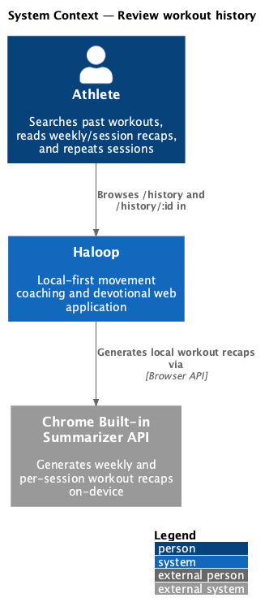
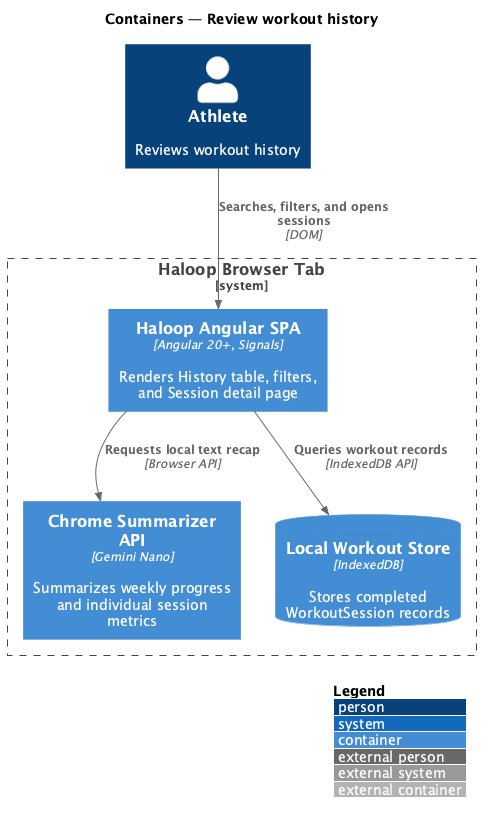
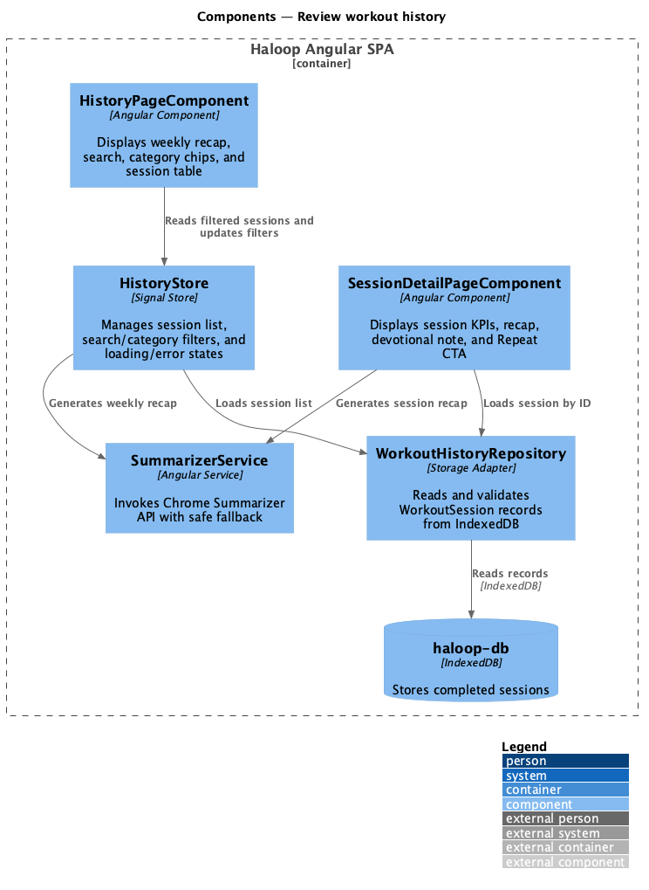
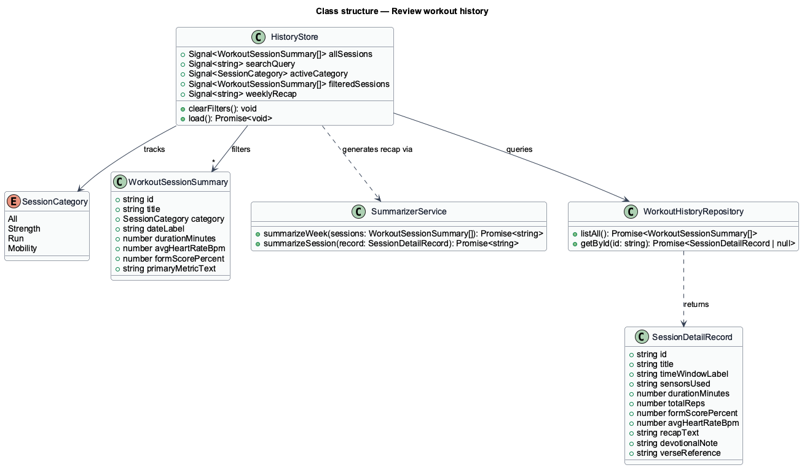
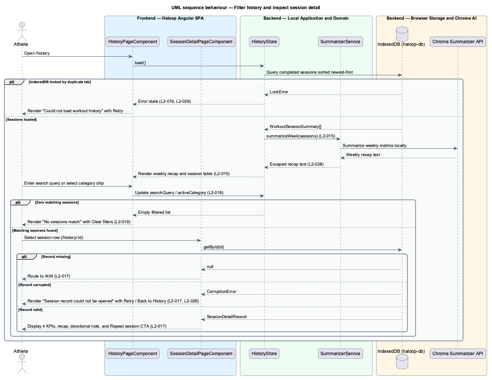

# Review workout history

## Overview

Haloop retains all completed workouts on the local device so the athlete can inspect performance trends, search past sessions, read on-device summaries, and repeat prior workouts. **On-device recap** — concise weekly or single-session summary generated locally by Chrome's built-in Gemini Nano Summarizer API from stored workout metrics. **Session detail** — individual workout record view at `/history/:id` presenting metadata, four KPI cards, an on-device recap, and the saved devotional reflection note.

The slice covers both `/history` and `/history/:id`. On `/history`, the athlete filters sessions by free-text query and category chips (`All`, `Strength`, `Run`, `Mobility`), with explicit handling for loading, empty, no-results, and IndexedDB lock errors. On `/history/:id`, missing IDs route cleanly to `/404`, corrupted records present a recoverable error state, and `Repeat session` launches `/train` preloaded with that workout's movements.

## Description

The slice connects the History list and Session detail components to IndexedDB storage and Chrome's Summarizer API.

- **`HistoryPageComponent`** — standalone Angular component at `/history`. It renders the weekly recap card, search input, category filter chips (`aria-pressed`), tabular session list, and loading, empty, no-results, and error states.
- **`SessionDetailPageComponent`** — standalone Angular component at `/history/:id`. It renders the breadcrumb back to `/history`, metadata header, `Repeat session` button, four KPI cards, session recap card, and devotional note card.
- **`HistoryStore`** — Signal-backed store holding loaded `WorkoutSession` summaries, active search query, selected `SessionCategory`, computed filtered list, and weekly recap text.
- **`SummarizerService`** — Angular adapter wrapping Chrome's built-in Summarizer API with deterministic fallback text when the API is unavailable.
- **`WorkoutHistoryRepository`** — IndexedDB adapter querying all sessions sorted newest-first and retrieving single sessions by `id`, catching lock and corruption errors.

## Requirements

The feature realizes the following level-2 (L2) requirements. Each L2 requirement refines a level-1 (L1) requirement, cited by identifier.

| L2 ID | Refines (L1) | Requirement |
|-------|--------------|-------------|
| `L2-015` | `L1-006` | The `/history` route shall display an on-device Chrome Summarizer weekly recap card alongside a newest-first table of completed local sessions linking to `/history/:id`. |
| `L2-016` | `L1-006` | The `/history` route shall support real-time keyword search and category filter chips (`All`, `Strength`, `Run`, `Mobility`) plus `loading`, `empty`, `no-results`, and IndexedDB lock `error` states. |
| `L2-017` | `L1-006` | The `/history/:id` route shall display breadcrumb, session metadata, `Repeat session` CTA, four KPI cards, on-device recap, and devotional note, handling corrupted records and routing missing IDs to `/404`. |
| `L2-026` | `L1-010` | The system shall catch IndexedDB lock and record corruption errors and present human-readable recovery actions without unhandled exceptions. |
| `L2-028` | `L1-011` | Search queries, session notes, and AI-generated recaps shall be rendered strictly as escaped text to prevent DOM XSS. |

## Diagrams

### System context

The athlete reviews past sessions and weekly summaries in Haloop using local IndexedDB data and Chrome's built-in Summarizer API.

### Containers

The Angular SPA queries completed sessions from IndexedDB and invokes Chrome's Summarizer API locally to generate weekly and per-session recaps.

### Components

`HistoryPageComponent` and `SessionDetailPageComponent` consume `HistoryStore`, `WorkoutHistoryRepository`, and `SummarizerService`.

### Class structure

`HistoryStore` filters `WorkoutSessionSummary` records by `SessionCategory` and keyword query, and delegates recap generation to `SummarizerService`.

### Behaviour — filter history and inspect session detail

Loading `/history` retrieves local sessions and generates a weekly recap (`L2-015`), applies search and category chips (`L2-016`), and navigates to `/history/:id` where missing records route to `/404` and corrupted records show recovery controls (`L2-017`, `L2-026`).

