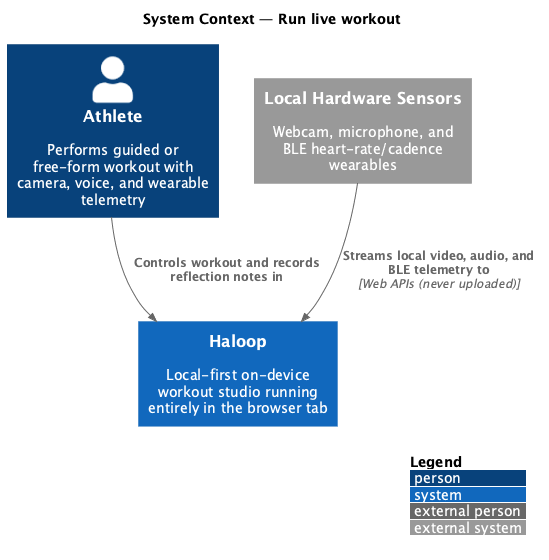
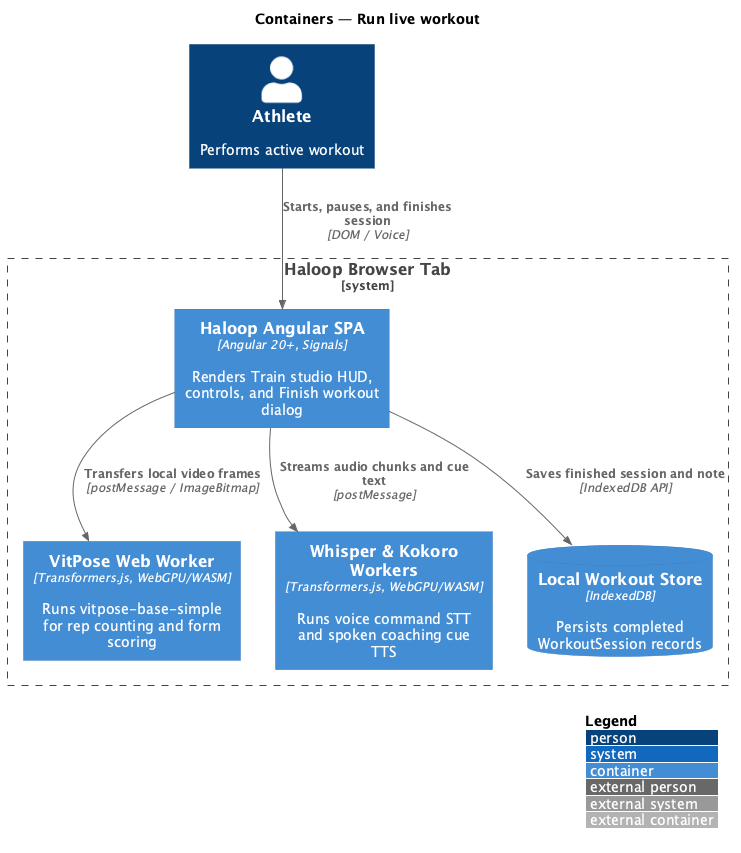
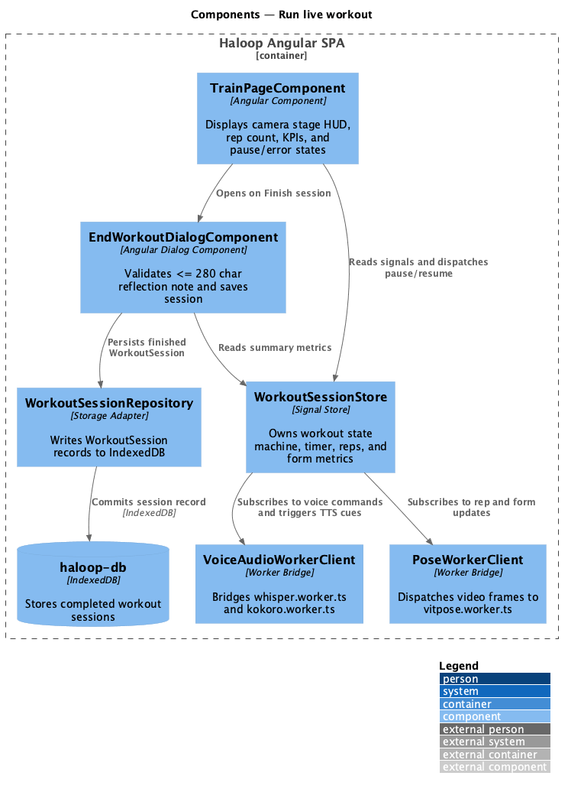
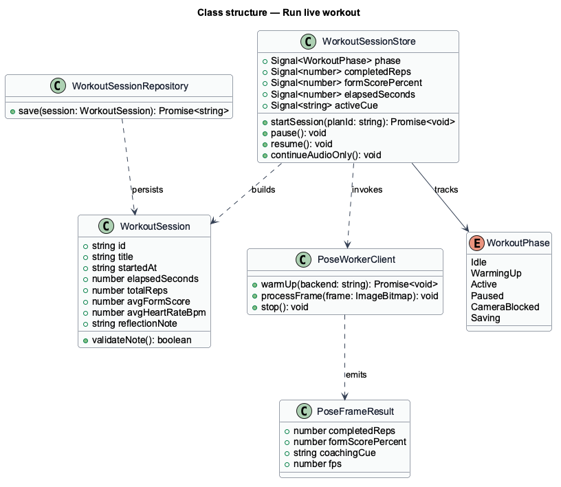
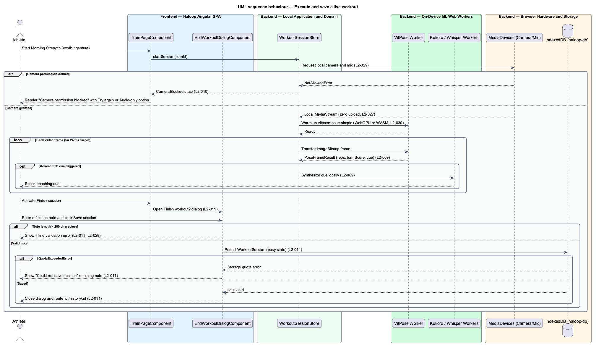

# Run live workout

## Overview

The Train studio at `/train` executes guided and free-form workouts inside the browser tab with real-time computer vision, spoken audio cues, voice control, and Bluetooth wearable telemetry. **Pose estimation pipeline** — Web Worker inference loop running `onnx-community/vitpose-base-simple` over local `MediaDevices.getUserMedia` video frames to count repetitions and calculate a percentage **form score** (measure of joint-angle alignment against exercise targets). **Audio-only fallback** — degraded workout mode that retains Kokoro text-to-speech cues and timer progression when camera permission is denied.

Camera video, microphone audio, and wearable heart-rate streams never leave the browser tab. The athlete can pause and resume a session without losing completed sets, finish a workout via the modal `Finish workout?` dialog, attach an optional reflection note up to `280` characters, and persist the completed session to local IndexedDB.

## Description

The slice spans the Angular Train UI, dedicated Web Workers for ML inference, browser media/Bluetooth streams, and IndexedDB session storage.

- **`TrainPageComponent`** — standalone Angular component at `/train`. It renders the live camera stage HUD (`Camera local · never uploaded`, rep counter, form score, elapsed timer, heart-rate zone, voice command indicator), telemetry KPI cards, and loading, empty, paused, and camera-blocked states.
- **`EndWorkoutDialogComponent`** — modal dialog triggered by `Finish session`. It displays elapsed duration, total reps, and form score, validates the optional reflection note (`<= 280` characters), manages `busy` and `failed` quota states, and navigates to `/history/:id` on save.
- **`WorkoutSessionStore`** — Signal-backed state machine owning active session status (`Idle`, `WarmingUp`, `Active`, `Paused`, `CameraBlocked`, `Saving`), rep counts, elapsed seconds, and live coaching cues.
- **`PoseWorkerClient`** — typed Angular bridge to the VitPose Web Worker (`vitpose.worker.ts`) streaming video frames off the main thread at `>= 24 fps` on WebGPU (or automatic WebAssembly CPU fallback).
- **`VoiceAudioWorkerClient`** — typed bridge to `whisper.worker.ts` (speech-to-text commands such as `"Next set"` and `"Pause"`) and `kokoro.worker.ts` (local text-to-speech cues).
- **`WorkoutSessionRepository`** — IndexedDB adapter persisting completed `WorkoutSession` records in `haloop-db`.

## Requirements

The feature realizes the following level-2 (L2) requirements. Each L2 requirement refines a level-1 (L1) requirement, cited by identifier.

| L2 ID | Refines (L1) | Requirement |
|-------|--------------|-------------|
| `L2-009` | `L1-004` | The `/train` route shall run live workouts using `onnx-community/vitpose-base-simple` locally to count reps and compute form scores, displaying privacy status, rep counter, elapsed timer, Kokoro TTS cues, Whisper voice readiness, and live wearable KPIs. |
| `L2-010` | `L1-004` | The `/train` route shall handle model warm-up loading, pre-workout empty state, paused state preserving progress, and blocked camera permission with audio-only coaching fallback. |
| `L2-011` | `L1-004` | Activating `Finish session` shall open the `Finish workout?` dialog validating optional notes to `<= 280` characters, preventing duplicate writes in `busy` state, handling storage quota errors, and navigating to `/history/:id` upon save. |
| `L2-027` | `L1-011` | The system shall never transmit camera frames, microphone audio, Web Bluetooth streams, or workout history to any remote server. |
| `L2-028` | `L1-011` | All user-entered text (including reflection notes) shall be validated for length bounds and rendered strictly as escaped text. |
| `L2-029` | `L1-011` | The system shall request camera and microphone permissions exclusively upon explicit user gesture and degrade cleanly when denied or revoked. |
| `L2-030` | `L1-012` | Transformers.js pipelines (VitPose, Whisper, Kokoro) shall execute inside dedicated Web Workers keeping UI interaction latency `<= 100 ms`, targeting `>= 24–30 fps` on WebGPU with automatic WASM fallback. |

## Diagrams

### System context

The athlete trains in Haloop using local camera, microphone, and Bluetooth heart-rate hardware with zero outbound network transmission.

### Containers

The Angular SPA coordinates local media capture and three dedicated Transformers.js Web Workers (VitPose, Whisper, Kokoro), persisting finished workouts to IndexedDB.

### Components

`TrainPageComponent` and `EndWorkoutDialogComponent` interact with `WorkoutSessionStore`, `PoseWorkerClient`, `VoiceAudioWorkerClient`, and `WorkoutSessionRepository`.

### Class structure

`WorkoutSessionStore` manages `LiveWorkoutState`, transitions across `WorkoutPhase`, consumes `PoseFrameResult` events, and produces persisted `WorkoutSession` records.

### Behaviour — execute and save a live workout

After explicit user gesture (`L2-029`), the camera stream feeds the VitPose Web Worker (`L2-009`, `L2-030`) with zero cloud relay (`L2-027`), handles camera denial (`L2-010`), and saves validated reflection notes via `EndWorkoutDialogComponent` (`L2-011`, `L2-028`).

