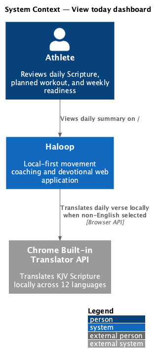
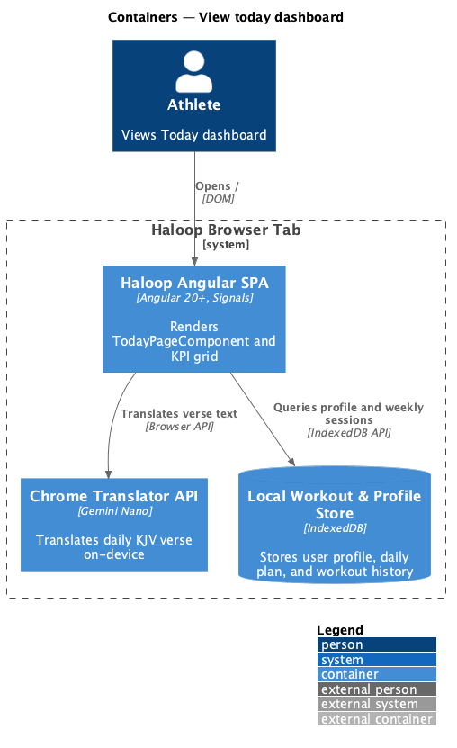
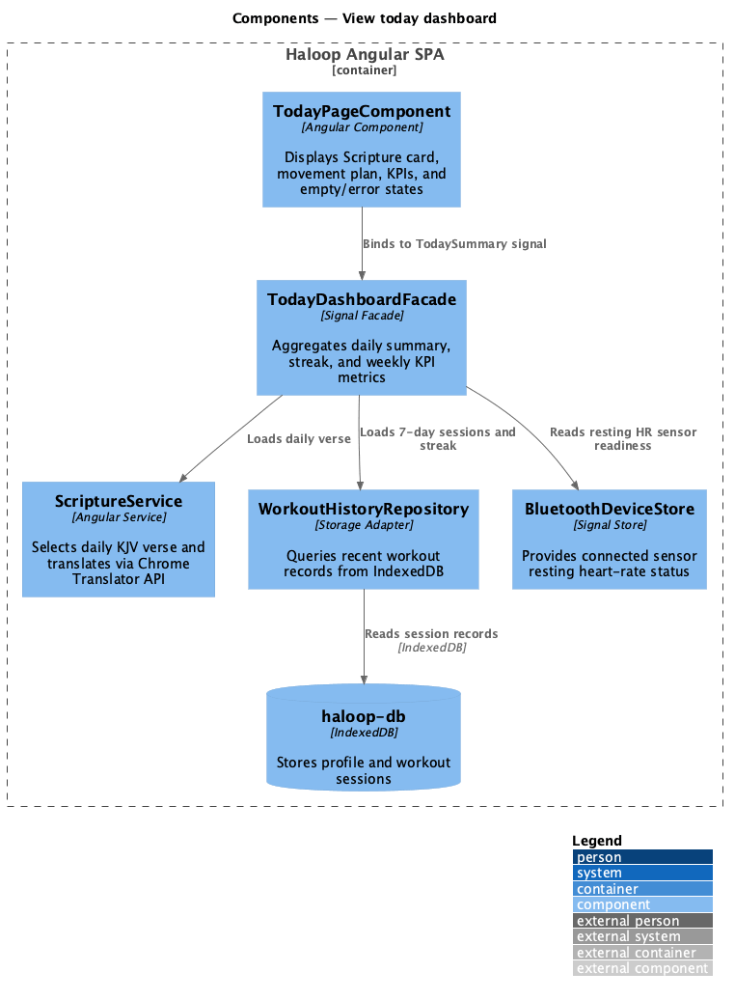
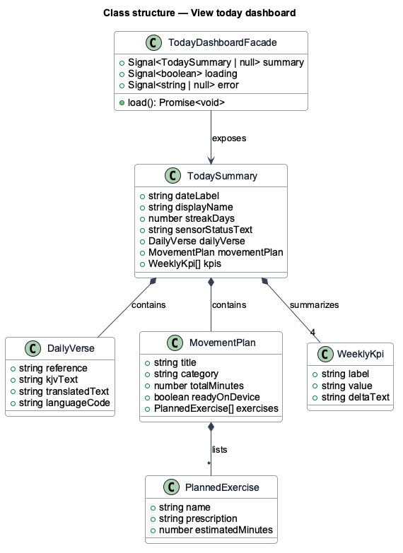
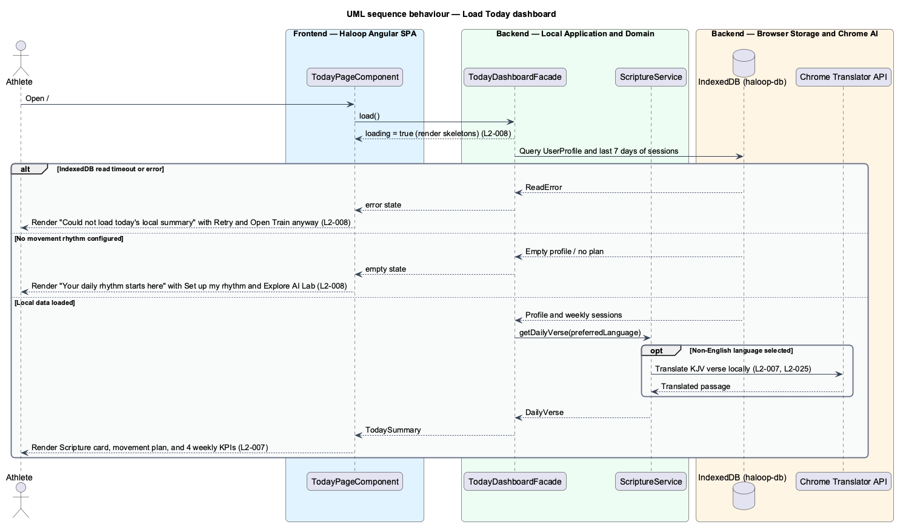

# View today dashboard

## Overview

The Today dashboard at `/` serves as the athlete's daily entry point into Haloop. **Daily rhythm** — combination of a daily King James Version (KJV) Scripture passage, a scheduled movement plan, and rolling seven-day readiness metrics. **Readiness KPI** — summary metric (`Sessions`, `Avg form score`, `Active minutes`, or `Resting HR`) calculated locally from completed workouts and connected wearable readings.

When the athlete opens `/`, the dashboard loads local profile data, daily Scripture (translated on-device when a non-English language is configured), today's movement plan with ordered exercises, and weekly KPIs. If no rhythm is configured, the dashboard presents a first-run empty state linking to `/welcome` and `/lab`. If IndexedDB encounters a read timeout, the error state preserves direct access to `/train`.

## Description

The slice connects the Today route component to local repositories, Scripture services, and Bluetooth readiness state.

- **`TodayPageComponent`** — standalone Angular component at `/`. It renders the greeting header, Scripture card, movement plan card, four-card KPI grid, and loading, empty, and error states.
- **`TodayDashboardFacade`** — Signal-backed facade aggregating `UserProfileStore`, `WorkoutHistoryRepository`, `ScriptureService`, and `BluetoothDeviceStore` into a single `TodaySummary` view model.
- **`ScriptureService`** — local service selecting the daily KJV passage and invoking Chrome's built-in Translator API when the user's configured language is not English.
- **`WorkoutHistoryRepository`** — IndexedDB data-access adapter querying recent sessions to compute weekly totals, active streak, and average form score.
- **`TodaySummary`** — immutable view model containing `greeting`, `streakDays`, `dailyVerse`, `movementPlan`, and `weeklyKpis`.

## Requirements

The feature realizes the following level-2 (L2) requirements. Each L2 requirement refines a level-1 (L1) requirement, cited by identifier.

| L2 ID | Refines (L1) | Requirement |
|-------|--------------|-------------|
| `L2-007` | `L1-003` | The `/` route shall display the current date, personalized greeting, streak, sensor readiness, Today's Scripture card, Today's movement plan with exercise breakdown, and four weekly KPI cards. |
| `L2-008` | `L1-003` | The `/` route shall handle skeleton loading, first-run empty configuration, and IndexedDB read timeout errors while preserving access to `/train`. |
| `L2-025` | `L1-010` | Once cached, Today's dashboard and daily Scripture shall function with zero network connectivity. |
| `L2-032` | `L1-013` | The Today dashboard shall adapt cleanly across XS through XL viewports, stacking KPI grids and cards without horizontal overflow. |

## Diagrams

### System context

The athlete reviews daily Scripture, today's workout plan, and weekly readiness metrics in Haloop using local storage and Chrome's built-in Translator API.

### Containers

The Angular SPA queries IndexedDB for workout history and profile settings and invokes Chrome's Translator API locally when Scripture translation is active.

### Components

`TodayPageComponent` reads reactive state from `TodayDashboardFacade`, which combines data from `ScriptureService`, `WorkoutHistoryRepository`, and `BluetoothDeviceStore`.

### Class structure

`TodayDashboardFacade` produces `TodaySummary` composed of `DailyVerse`, `MovementPlan`, `PlannedExercise`, and `WeeklyKpi` records.

### Behaviour — load Today dashboard

On activation of `/`, `TodayPageComponent` displays skeletons while `TodayDashboardFacade` queries IndexedDB (`L2-008`), translates daily Scripture locally if needed (`L2-007`), and renders the default, empty, or error view.

