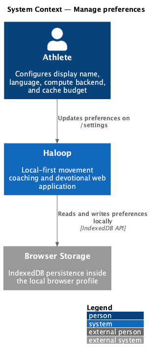
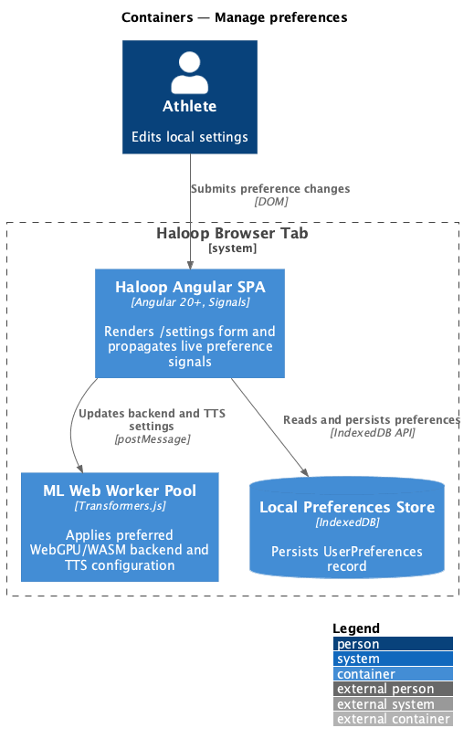
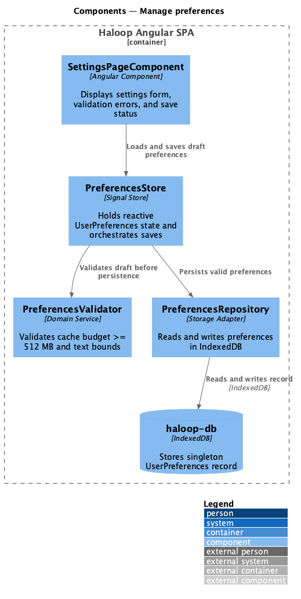
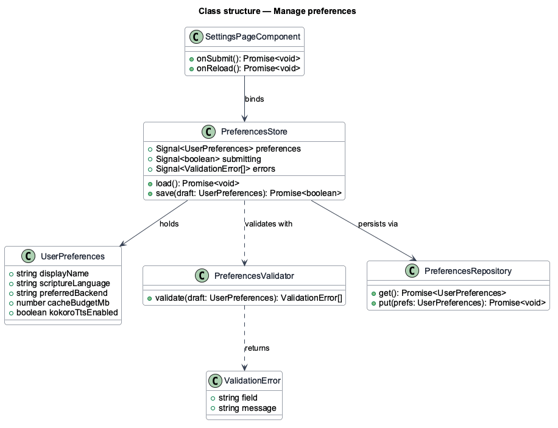
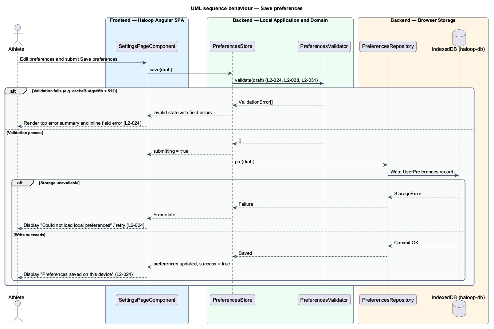

# Manage preferences

## Overview

Haloop stores user configuration locally on the device so that units, Scripture translation language, inference backend selection, model cache limits, and spoken coaching cues apply immediately without remote synchronization. **Cache budget** — upper storage limit in megabytes (minimum `512 MB`, default `2048 MB`) governing Hugging Face model downloads in browser cache storage. **Inference backend** — execution target (`AutoWebGpu` or `WasmCpu`) passed to Transformers.js Web Workers.

The preference management slice allows the athlete to update these settings on `/settings`, validates numeric and text constraints before writing, surfaces top-level and inline errors on invalid input, and applies valid changes across active services immediately.

## Description

The slice connects the reactive Settings form to local preference storage and downstream runtime services.

- **`SettingsPageComponent`** — standalone Angular component at `/settings`. It binds form controls for display name, Scripture language, preferred inference backend, model cache budget, and Kokoro TTS cues, and renders loading, error, invalid, submitting, and success states.
- **`PreferencesStore`** — Signal-backed Angular store holding the current `UserPreferences` state and exposing `load()` and `save(draft)` operations.
- **`PreferencesValidator`** — pure validation service enforcing `cacheBudgetMb >= 512`, non-empty display name bounds, and XSS-safe string sanitization.
- **`PreferencesRepository`** — IndexedDB adapter reading and writing the singleton `UserPreferences` record in `haloop-db`.
- **`UserPreferences`** — domain model containing `displayName`, `scriptureLanguage`, `preferredBackend`, `cacheBudgetMb`, and `kokoroTtsEnabled`.

## Requirements

The feature realizes the following level-2 (L2) requirements. Each L2 requirement refines a level-1 (L1) requirement, cited by identifier.

| L2 ID | Refines (L1) | Requirement |
|-------|--------------|-------------|
| `L2-024` | `L1-009` | The `/settings` route shall provide a validated form for display name, Scripture language, preferred inference backend, model cache budget (minimum 512 MB), and Kokoro TTS toggle with immediate local persistence and full state handling. |
| `L2-028` | `L1-011` | All user-entered text and on-device AI outputs shall be validated for type and length bounds and rendered strictly as escaped text to prevent DOM XSS and injection attacks. |
| `L2-031` | `L1-012` | The system shall enforce the user-configured model cache budget (default 2048 MB, minimum 512 MB) before committing new model downloads. |
| `L2-033` | `L1-013` | The system shall style all views via semantic CSS custom properties supporting light and dark themes and system media preferences. |
| `L2-034` | `L1-013` | All pages, dialogs, and notifications shall conform to WCAG 2.2 AA for contrast, semantic landmarks, keyboard navigation, focus management, and assistive technology announcements. |

## Diagrams

### System context

The athlete updates local preferences inside Haloop, which writes configuration solely to local browser storage.

### Containers

The Angular SPA validates preference edits and commits them to IndexedDB, while updating active runtime configuration signals.

### Components

`SettingsPageComponent` delegates validation to `PreferencesValidator` and persistence to `PreferencesStore` and `PreferencesRepository`.

### Class structure

`PreferencesStore` uses `PreferencesValidator` and `PreferencesRepository` to manage `UserPreferences` and return structured `ValidationResult` outcomes.

### Behaviour — update preferences

Submitting `/settings` validates the cache budget (`L2-024`, `L2-031`) and sanitizes the display name (`L2-028`), transitions the form through `submitting`, persists to IndexedDB, and broadcasts the saved confirmation.

