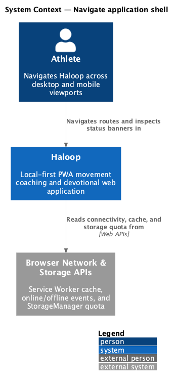
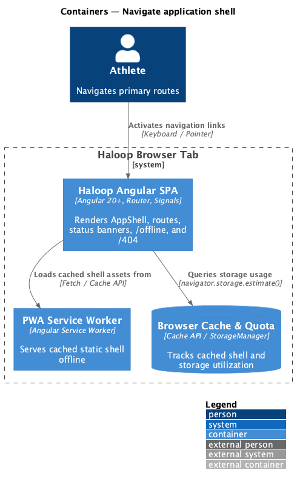
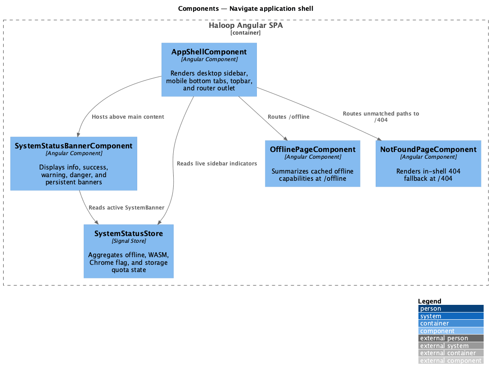
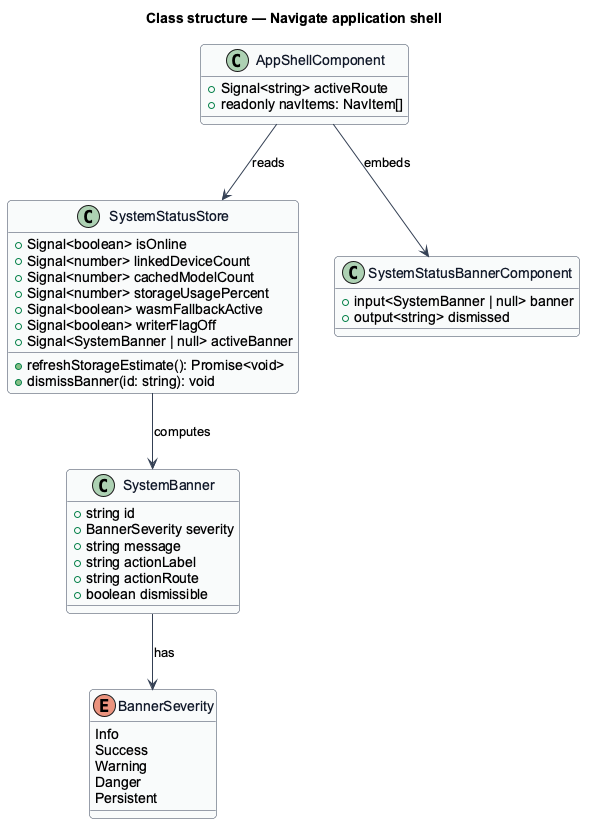
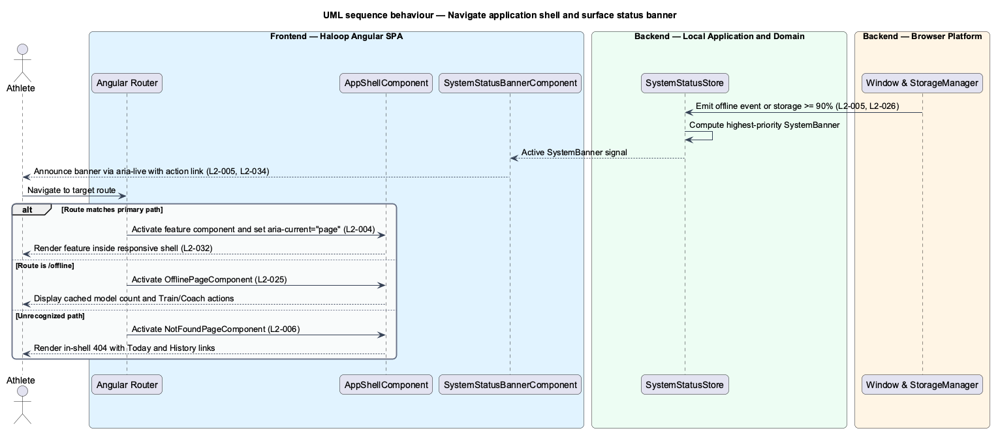

# Navigate application shell

## Overview

Every in-app screen in Haloop renders inside a shared **application shell** — persistent layout frame supplying primary route navigation, live hardware and artificial intelligence readiness indicators, top-level system status banners, and fallback pages. **System status banner** — full-width notification bar above main content announcing offline connectivity, reconnection, WebAssembly CPU fallback, near-full browser storage, or disabled Chrome built-in AI flags.

The shell adapts navigation across desktop and mobile viewports: viewports at or above `992 px` display a sticky left sidebar with all seven routes (`Today`, `Train`, `Coach`, `History`, `Devices`, `AI Lab`, and `Settings`), whereas narrower viewports display a bottom mobile tab bar (`Today`, `Train`, `Coach`, `History`) paired with topbar quick-action links for `Devices` and `AI Lab`. Unknown routes resolve to `/404` inside the shell, and offline inspection resolves to `/offline`.

## Description

The slice coordinates Angular routing, responsive navigation chrome, service-worker connectivity signals, and system banners.

- **`AppShellComponent`** — standalone Angular layout component wrapping `<router-outlet>`, semantic landmarks (`<aside>`, `<header>`, `<main id="main">`, `<nav>`), and the skip-to-content link.
- **`SystemStatusBannerComponent`** — standalone Angular component rendering `info`, `success`, `warning`, `danger`, and `persistent` banners with `aria-live` announcements and action links.
- **`SystemStatusStore`** — Signal-backed store aggregating `navigator.onLine`, Service Worker cache status, active WebGPU/WASM backend, storage quota percentage, and Chrome flag readiness.
- **`OfflinePageComponent`** — standalone Angular component at `/offline` summarizing cached models and linking directly to `/train` and `/coach`.
- **`NotFoundPageComponent`** — standalone Angular component at `/404` presenting recovery links to `/` and `/history`.
- **`SystemBanner`** — immutable view-model representing banner `severity`, `message`, `actionLabel`, `actionRoute`, and `persistent` flag.

## Requirements

The feature realizes the following level-2 (L2) requirements. Each L2 requirement refines a level-1 (L1) requirement, cited by identifier.

| L2 ID | Refines (L1) | Requirement |
|-------|--------------|-------------|
| `L2-004` | `L1-002` | All in-app pages shall render inside a consistent application shell providing navigation across the seven primary sections, active-route indication, and live sidebar status indicators. |
| `L2-005` | `L1-002` | The application shell shall surface top-level system status banners for offline mode, reconnection, CPU WebAssembly fallback, near-full storage, and disabled Chrome built-in AI flags. |
| `L2-006` | `L1-002` | Any unrecognized application route or request for a non-existent session identifier shall render the `/404` page inside the application shell with recovery links. |
| `L2-025` | `L1-010` | Once cached, all core workflows shall function offline and `/offline` shall summarize cached model readiness with links to `/train` and `/coach`. |
| `L2-026` | `L1-010` | The system shall monitor browser storage quota and surface a warning banner when usage reaches or exceeds 90% of the configured budget. |
| `L2-032` | `L1-013` | Every page, dialog, and notification shall adapt cleanly across XS (<576px), SM (>=576px), MD (>=768px), LG (>=992px), and XL (>=1200px) viewports. |
| `L2-034` | `L1-013` | All pages, dialogs, and notifications shall conform to WCAG 2.2 AA for contrast, semantic landmarks, keyboard navigation, focus management, and assistive technology announcements. |

## Diagrams

### System context

The athlete navigates Haloop across desktop and mobile viewports while the browser supplies offline state, storage quota telemetry, and service-worker caching.

### Containers

The Angular SPA coordinates with the PWA Service Worker and browser storage quota APIs to render routes and status banners without network dependency.

### Components

`AppShellComponent` hosts `SystemStatusBannerComponent`, `OfflinePageComponent`, and `NotFoundPageComponent`, reading reactive state from `SystemStatusStore`.

### Class structure

`SystemStatusStore` computes active `SystemBanner` instances from `BannerSeverity`, connectivity events, and storage usage metrics.

### Behaviour — resolve route and display status banner

When the browser transitions offline or exceeds 90% storage quota, `SystemStatusStore` emits a `SystemBanner` (`L2-005`, `L2-026`), while the Angular router resolves valid routes, `/offline` (`L2-025`), or `/404` (`L2-006`) inside the shell.

