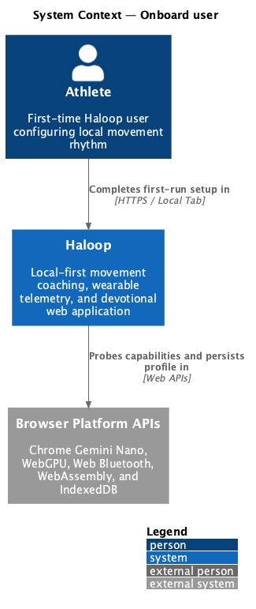
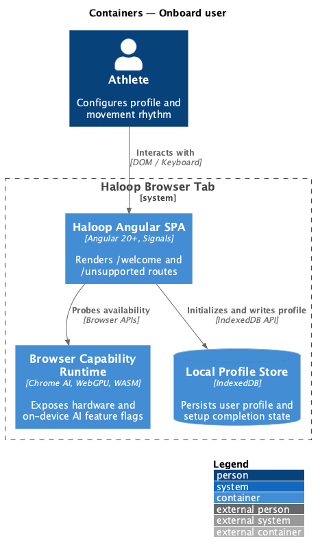
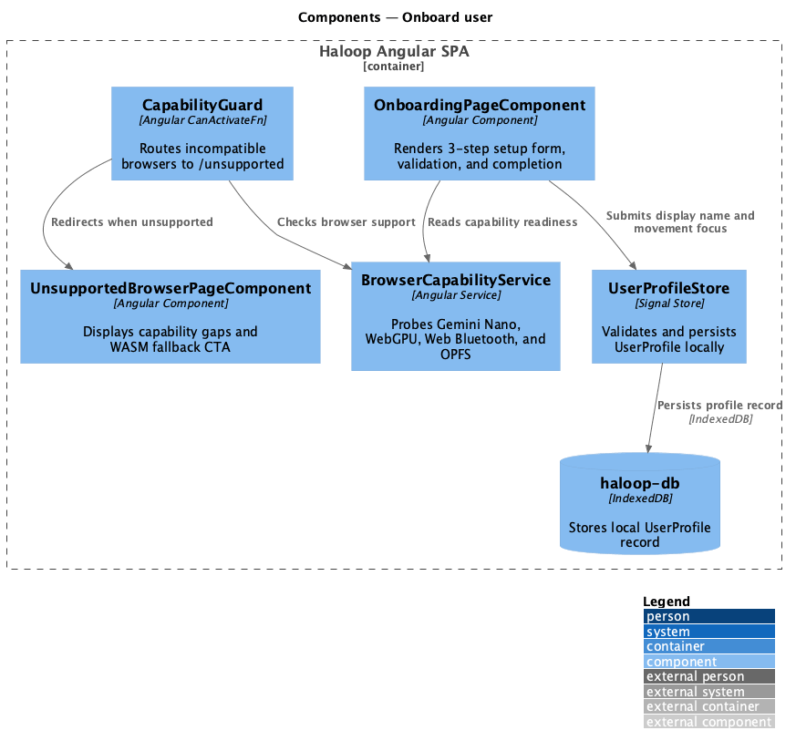
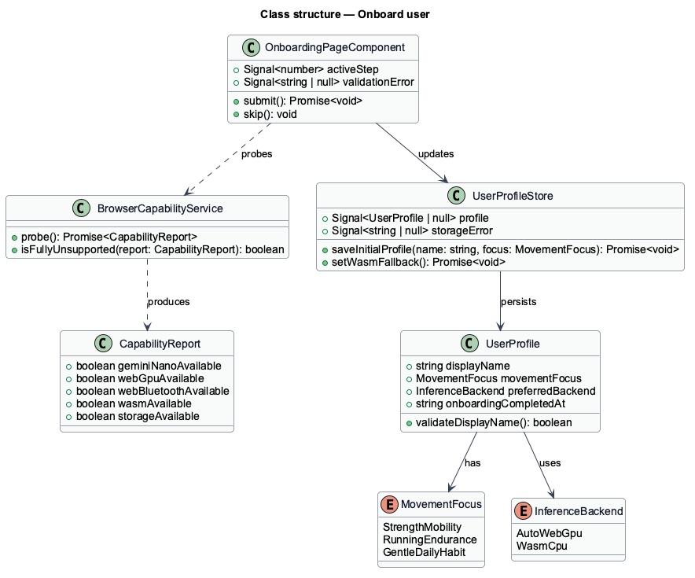
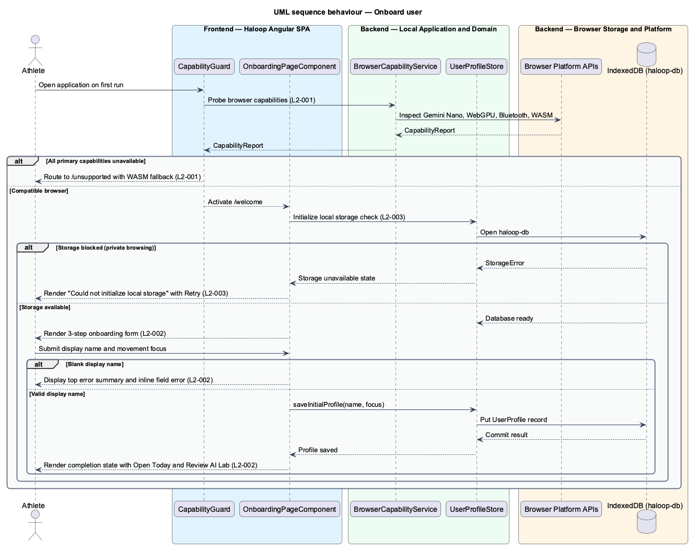

# Onboard user

## Overview

Haloop is a local-first movement coaching, wearable telemetry, and daily devotional web application that executes artificial intelligence models inside the browser tab. **Browser capability probing** — synchronous and asynchronous inspection of Chrome Built-in AI (Gemini Nano), WebGPU, Web Bluetooth, WebAssembly, and persistent browser storage before user setup. **Movement rhythm** — weekly training focus selected by the user to shape daily session plans.

First-time users enter Haloop without creating a remote account or signing in. The onboarding slice verifies browser compatibility, routes unsupported browsers to a fallback screen offering WebAssembly CPU execution, collects a display name and movement rhythm, and initializes local storage. When persistent storage is blocked (such as in private browsing), the slice presents a recoverable pause state rather than failing silently.

## Description

The slice spans the Angular presentation layer, browser capability adapters, and local storage persistence.

- **`CapabilityGuard`** — Angular functional route guard (`CanActivateFn`). It invokes `BrowserCapabilityService` on initial navigation and redirects to `/unsupported` when Gemini Nano, WebGPU, and Web Bluetooth are all unavailable.
- **`UnsupportedBrowserPageComponent`** — standalone Angular component at `/unsupported`. It displays per-capability availability statuses and offers navigation into WebAssembly CPU mode (`/lab`) or `/`.
- **`OnboardingPageComponent`** — standalone Angular component at `/welcome`. It renders the three-step progress stepper (`Browser check`, `Your rhythm`, `Ready`), loading state, validation summary, completion screen, and storage error recovery state.
- **`BrowserCapabilityService`** — Angular service that inspects `window.ai`, `navigator.gpu`, `navigator.bluetooth`, `WebAssembly`, and Origin Private File System (OPFS) availability.
- **`UserProfileStore`** — Signal-backed local state store managing `UserProfile` persistence in IndexedDB (`haloop-db`).
- **`UserProfile`** — domain model storing `displayName`, `movementFocus`, `preferredBackend`, and `onboardingCompletedAt`.
- **`MovementFocus`** — enumeration of supported weekly focuses: `StrengthMobility`, `RunningEndurance`, and `GentleDailyHabit`.

## Requirements

The feature realizes the following level-2 (L2) requirements. Each L2 requirement refines a level-1 (L1) requirement, cited by identifier.

| L2 ID | Refines (L1) | Requirement |
|-------|--------------|-------------|
| `L2-001` | `L1-001` | On initial application load, the system shall synchronously probe browser support for Chrome built-in Gemini Nano APIs, WebGPU, Web Bluetooth, and WebAssembly, and route incompatible browsers to `/unsupported` with a WebAssembly CPU fallback path. |
| `L2-002` | `L1-001` | First-time users with no saved local profile shall be guided through `/welcome` with a three-step stepper, capability readout, required display name, weekly movement focus selection, and skip option. |
| `L2-003` | `L1-001` | When browser storage cannot be initialized during onboarding, the system shall display a recoverable error state explaining the restriction and offering retry. |
| `L2-032` | `L1-013` | Every page, dialog, and notification shall adapt cleanly across XS (<576px), SM (>=576px), MD (>=768px), LG (>=992px), and XL (>=1200px) viewports with zero unintended horizontal overflow. |
| `L2-033` | `L1-013` | The system shall style all views via semantic CSS custom properties supporting light and dark themes, `prefers-reduced-motion`, `prefers-contrast`, and `forced-colors`. |
| `L2-034` | `L1-013` | All pages, dialogs, and notifications shall conform to WCAG 2.2 AA for contrast, semantic landmarks, keyboard navigation, focus management, and assistive technology announcements. |

## Diagrams

### System context

The athlete opens Haloop in a desktop or mobile browser, and the application inspects local browser APIs and storage without contacting remote authentication servers.

### Containers

The Angular single-page application probes Chrome Built-in AI and WebGPU/WebAssembly runtimes and persists the initial profile in local IndexedDB storage.

### Components

Inside the Angular SPA, `CapabilityGuard` and `OnboardingPageComponent` coordinate with `BrowserCapabilityService` and `UserProfileStore` to validate input and store the profile.

### Class structure

`OnboardingPageComponent` depends on `BrowserCapabilityService` and `UserProfileStore`, which persists `UserProfile` containing a `MovementFocus` value.

### Behaviour — onboard a user

On route entry, `CapabilityGuard` evaluates browser capabilities (`L2-001`); when supported, `OnboardingPageComponent` validates the display name (`L2-002`) and persists the profile to IndexedDB, handling storage initialization failures (`L2-003`).

