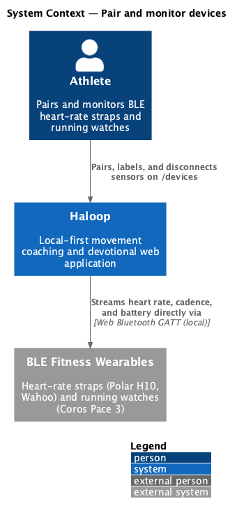
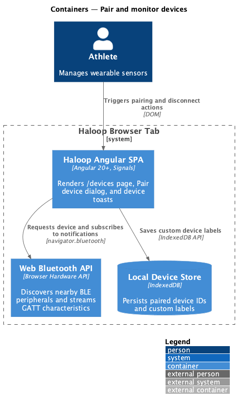
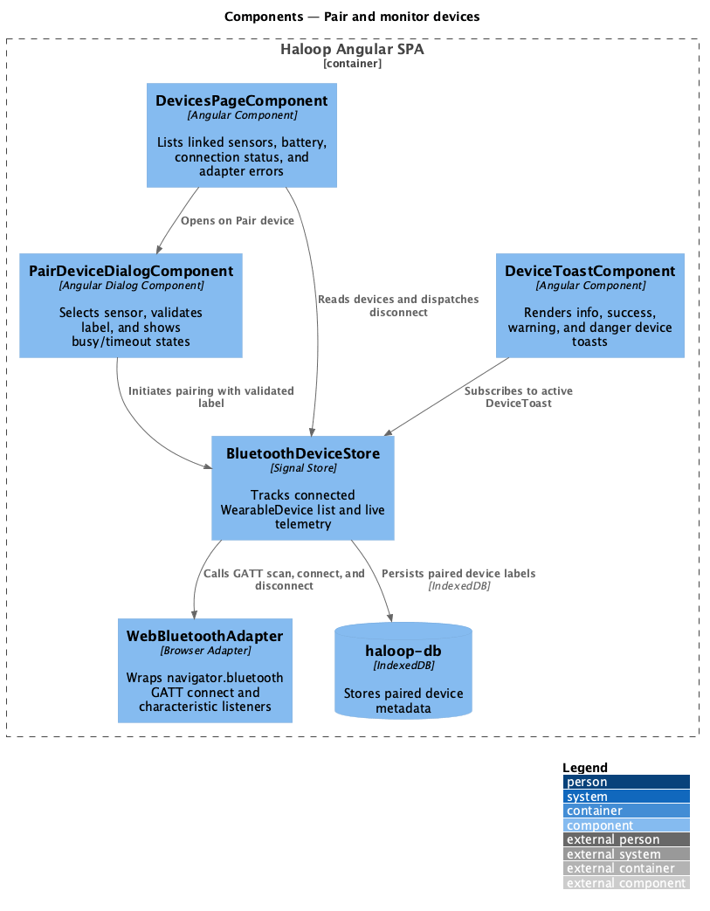
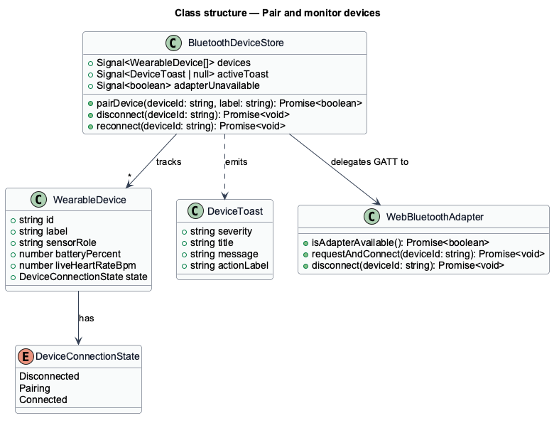
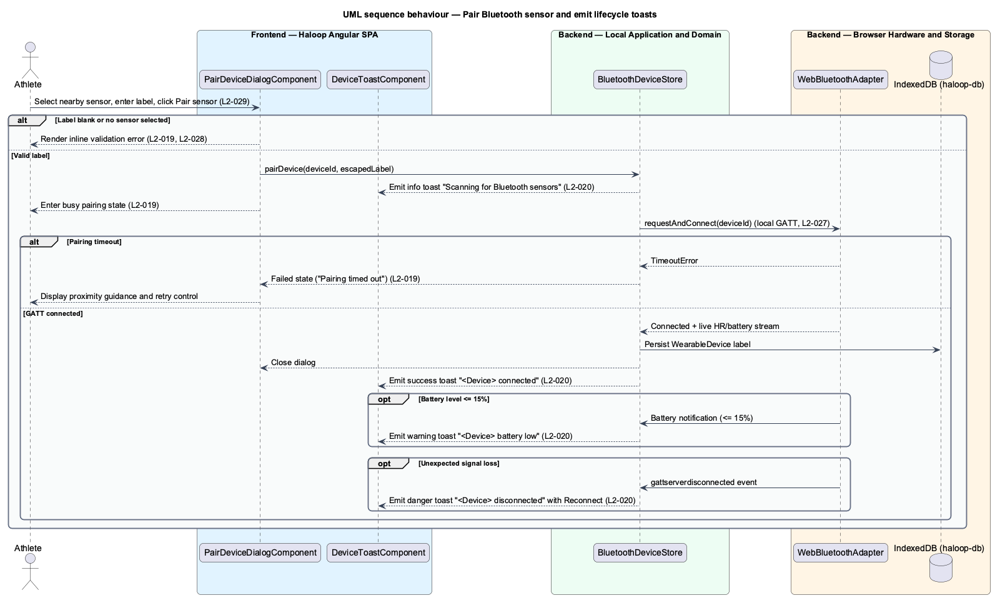

# Pair and monitor devices

## Overview

Haloop connects directly from the browser tab to Bluetooth Low Energy (BLE) fitness sensors—such as heart-rate chest straps and running watches—without a companion phone application or cloud relay. **Web Bluetooth GATT stream** — direct browser-to-peripheral subscription to standard BLE Heart Rate (`0x180D`), Running Speed and Cadence (`0x1814`), and Battery Service (`0x180F`) characteristics. **Device toast** — non-blocking accessible status notification announcing sensor discovery (`info`), connection (`success`), low battery (`warning`, `<= 15%`), or signal loss (`danger` with `Reconnect` action).

On `/devices`, the athlete inspects linked devices, monitors live battery and connection states, disconnects or reconnects sensors, and opens the modal `Pair Bluetooth device` dialog. Pairing requests browser Bluetooth permission exclusively on explicit user gesture, validates a non-empty device label, handles pairing timeouts cleanly, and streams telemetry solely to local in-tab consumers.

## Description

The slice spans the Devices page, the pairing dialog, toast notifications, the Web Bluetooth GATT adapter, and local device metadata storage.

- **`DevicesPageComponent`** — standalone Angular component at `/devices`. It lists linked BLE sensors with battery percentage, live metric, connection status, and `Disconnect` / `Reconnect` buttons, plus loading, empty, and Bluetooth-adapter-off error states.
- **`PairDeviceDialogComponent`** — modal Angular dialog triggered by `Pair device`. It presents nearby BLE sensors, validates a required `Device label` (`invalid` state), manages `busy` GATT pairing, and displays `Pairing timed out` on failure (`failed` state).
- **`DeviceToastComponent`** — accessible toast component (`role="status"` / `role="alert"`) displaying `info`, `success`, `warning`, and `danger` device lifecycle messages.
- **`BluetoothDeviceStore`** — Signal-backed store maintaining linked `WearableDevice[]`, live `HeartRateReading` / `CadenceReading` streams, and emitting `DeviceToast` notifications.
- **`WebBluetoothAdapter`** — browser hardware adapter encapsulating `navigator.bluetooth.requestDevice()`, GATT characteristic notifications, and `gattserverdisconnected` events.

## Requirements

The feature realizes the following level-2 (L2) requirements. Each L2 requirement refines a level-1 (L1) requirement, cited by identifier.

| L2 ID | Refines (L1) | Requirement |
|-------|--------------|-------------|
| `L2-018` | `L1-007` | The `/devices` route shall list linked BLE sensors with name, role, battery percentage, connection status, `Disconnect` control, `Pair device` CTA, and `loading`, `empty`, and adapter-off `error` states. |
| `L2-019` | `L1-007` | Activating `Pair device` shall open the `Pair Bluetooth device` dialog allowing sensor selection, required device label validation, `busy` pairing, and timeout `failed` recovery. |
| `L2-020` | `L1-007` | Bluetooth sensor lifecycle events shall emit accessible `device-toast` notifications for scanning (`info`), connection (`success`), low battery `<= 15%` (`warning`), and unexpected disconnect (`danger` with `Reconnect`). |
| `L2-027` | `L1-011` | Web Bluetooth biometric streams shall remain strictly inside the browser tab with zero remote upload. |
| `L2-028` | `L1-011` | Custom device labels shall be validated and rendered strictly as escaped text to prevent DOM XSS. |
| `L2-029` | `L1-011` | Web Bluetooth permission shall be requested exclusively upon explicit user gesture and shall degrade cleanly when denied or revoked. |

## Diagrams

### System context

The athlete pairs BLE heart-rate straps and running watches directly with Haloop via the browser's Web Bluetooth stack without any cloud relay.

### Containers

The Angular SPA communicates with nearby BLE sensors over Web Bluetooth GATT and persists paired device labels in local IndexedDB storage.

### Components

`DevicesPageComponent`, `PairDeviceDialogComponent`, and `DeviceToastComponent` coordinate through `BluetoothDeviceStore` and `WebBluetoothAdapter`.

### Class structure

`BluetoothDeviceStore` manages `WearableDevice` records and `DeviceToast` events using `WebBluetoothAdapter` and `DeviceConnectionState`.

### Behaviour — pair a Bluetooth sensor and handle telemetry events

Pairing triggers on explicit user gesture (`L2-029`), validates the custom device label (`L2-019`, `L2-028`), connects over GATT (`L2-027`), and emits lifecycle toasts for connection, low battery, and disconnect (`L2-020`).

